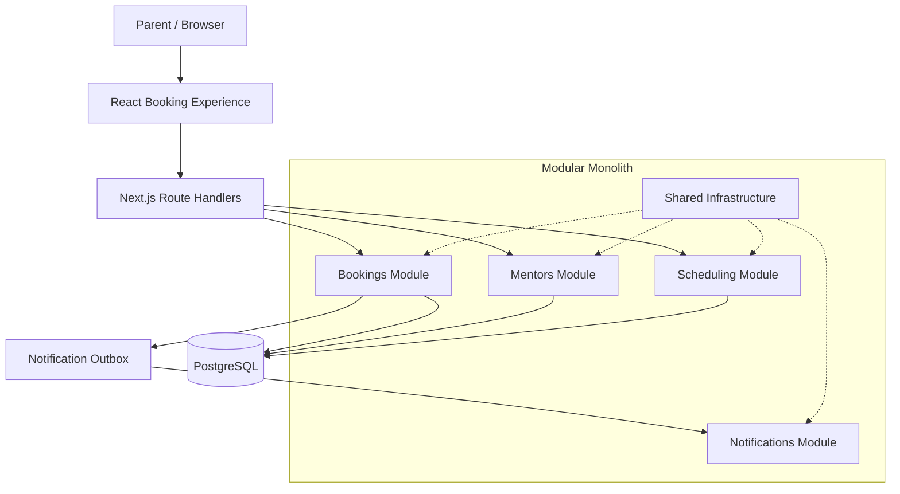

# Codeyoung Trial-Class Booking Platform
## Architecture and Engineering Design Rationale

**Project:** Codeyoung — Full-Stack Development Assignment  
**Architecture:** Modular Monolith  
**Primary Stack:** Next.js, React, TypeScript, PostgreSQL and Prisma

---

## 1. Project Overview

The Codeyoung Trial-Class Booking Platform is a timezone-aware appointment-booking application that allows parents to schedule a 45-minute trial coding class for their child.

The system models a business with ten mentors and approximately twenty prospective parent bookings per day. Parents can select their preferred date and time, enter parent and student information, and receive a confirmed booking with an assigned mentor and a dummy meeting-room link.

Although the functional requirements are relatively small, the application must address several important engineering problems:

- Parents and mentors can be in different timezones.
- Daylight Saving Time can create nonexistent or ambiguous local times.
- Multiple parents may attempt to book the same slot concurrently.
- Each mentor can conduct no more than two trial classes per mentor-local calendar day.
- Notification failures must not invalidate confirmed bookings.
- The interface must handle unavailable slots and failed submissions without misleading the parent.

The central design objective was therefore to build a **small, maintainable application with strong booking-integrity guarantees**, rather than a collection of UI screens connected to a simplistic booking endpoint.

## 2. Architectural Approach: Modular Monolith

The application uses a modular monolith architecture. The frontend, backend APIs and domain modules are part of a single Next.js application, backed by PostgreSQL.

A modular monolith combines two useful properties: the simplicity of deploying one application and the internal separation of business responsibilities into well-defined modules.

### Why this architecture?

A microservices architecture would introduce additional deployment, networking, observability and operational complexity without a meaningful benefit at this assignment's scale. Conversely, putting all business logic inside one large page component or a collection of API route handlers would make scheduling, concurrency and notification behavior harder to reason about and test.

The modular monolith offers a practical middle ground:

1. **Clear ownership:** Each module represents a distinct business capability.
2. **Controlled dependencies:** Modules expose supported functionality through public interfaces.
3. **Transactional consistency:** Booking creation, capacity checks and notification enqueueing can participate in one PostgreSQL transaction.
4. **Simple deployment:** The system remains one application with one primary relational database.
5. **Independent testing:** Domain behavior can be tested without coupling every test to the user interface.

The architecture is designed to keep business rules independent of React components and Next.js Route Handlers.

## 3. High-Level System Design

The following diagram illustrates the application's major components and their relationships.

The diagram illustrates the logical responsibilities, not separate deployments for each module. All backend modules run inside the same application.

## 4. Technology Choices and Rationale

| Technology | Responsibility | Reason for choosing it |
|---|---|---|
| Next.js App Router | Frontend and backend API entry points | Supports a single deployable application with integrated routing |
| React and TypeScript | Interactive booking experience | Component-based UI with explicit data contracts and compile-time checks |
| Tailwind CSS | Interface styling | Enables consistent, responsive styling without a separate design system dependency |
| PostgreSQL | Persistent data and booking integrity | Provides transactions, locking and database-enforced constraints |
| Prisma ORM | Database access and migrations | Provides typed data access and a maintainable schema workflow |
| Zod | Request validation | Validates incoming data at the application boundary |
| IANA timezones and timezone utilities | Local-time interpretation and conversion | Supports geographic timezone rules and Daylight Saving Time transitions |
| Vitest | Automated verification | Tests domain utilities, concurrency behavior and notification handling |
| Docker Compose | Local database environment | Makes local PostgreSQL setup reproducible |

The technology choices prioritize correctness and maintainability rather than adding tools for their own sake.

## 5. Module Boundaries and Responsibilities

The backend is organized into four business modules and shared infrastructure.

### 5.1 Mentors Module

**Responsibility:** Maintain mentor profiles, working schedules and eligibility information.

The module provides the information required to determine whether a mentor can conduct a trial class. It also supplies the mentor data needed for assignment and confirmation.

Its internal repository and persistence details should remain private. Other modules should use its public `index.ts` interface rather than importing its internal database implementation.

**Design rationale:** Mentor availability is a distinct business concern. Keeping it separate avoids duplicating working-hour and eligibility rules across scheduling and booking code.

### 5.2 Scheduling Module

**Responsibility:** Calculate available trial-class slots for a requested parent-local date and timezone.

The module considers the requested calendar date, parent timezone, trial duration, mentor working hours, existing confirmed bookings and each mentor's remaining daily capacity.

The current trial duration is 45 minutes.

Availability is calculated dynamically rather than relying on a permanently hardcoded list of available times.

**Design rationale:** Availability is derived from changing booking state. Keeping the calculation in a dedicated module allows it to be reused by the API and tested independently of the interface.

An availability result is a snapshot, not a reservation. A slot may be taken by another parent before the first parent confirms their booking. The booking transaction must therefore validate availability again.

### 5.3 Bookings Module

**Responsibility:** Enforce booking rules, assign an eligible mentor and manage the booking lifecycle.

This is the central domain module. It coordinates:

- Server-side request validation.
- Local date/time interpretation.
- Eligible mentor selection.
- Working-hour and availability checks.
- Overlap prevention.
- The two-bookings-per-mentor-local-day limit.
- Atomic booking creation.
- Generation of a unique dummy meeting link.
- Creation of notification outbox records.

The module exposes supported operations through its public interface rather than requiring callers to understand its repositories or transaction internals.

**Design rationale:** Booking correctness must be enforced centrally. A frontend check or an availability API alone cannot protect against simultaneous requests.

### 5.4 Notifications Module

**Responsibility:** Prepare and process parent and mentor confirmation notifications.

The module contains notification-related persistence, message rendering and retry behavior. Booking creation writes notification work into the outbox as part of the same database transaction.

The application also exposes notification previews through its existing notification API.

**Design rationale:** Notification delivery is a separate concern from booking validity. A confirmed appointment should not be rolled back simply because an email provider or delivery mechanism is temporarily unavailable.

A queued notification is not proof of successful email delivery, so the interface must not imply delivery unless the system has actually recorded it.

### 5.5 Shared Infrastructure

Shared utilities support the modules without becoming a place for unrelated business logic.

The principal shared responsibilities include:

- Database client configuration.
- Timezone validation and conversion.
- Common error handling.
- Reusable infrastructure types and helpers.

The intention is to share technical capabilities while keeping domain rules inside their owning modules.

## 6. API Design and Trust Boundaries

Next.js Route Handlers provide the HTTP boundary between the browser and the backend modules.

The principal endpoints are:

| Endpoint | Purpose |
|---|---|
| `GET /api/mentors` | Retrieve mentor information |
| `GET /api/slots` | Retrieve availability for a requested date and timezone |
| `POST /api/bookings` | Validate and create a booking |
| `GET /api/bookings` | Retrieve booking information where supported |
| `GET /api/notifications` | Inspect notification records or previews |

The Route Handlers should remain relatively thin: validate the request shape, call the appropriate module, and translate the result into an HTTP response.

### Server-authoritative booking

The browser can request a date, local time, timezone and parent/student details, but it must not be trusted to decide which mentor is available or to prove that a slot remains free.

The server independently resolves the requested local time, checks current availability and assigns an eligible mentor.

This separation matters because client-side availability can become stale and browser input can be manipulated.

Expected failures use appropriate HTTP status codes. For example, an unavailable or conflicting booking can return `409 Conflict`, while invalid input can return a validation response.

## 7. Timezone and Daylight Saving Time Design

Timezone handling is a core domain requirement, not merely a display-formatting concern.

### 7.1 Local time versus UTC

Parents generally think in their own local calendar and clock. Mentors may work in India, the United Kingdom or the United States.

The application therefore distinguishes between:

- The parent's requested local date and time.
- The parent's IANA timezone identifier.
- The resolved booking instant in UTC.
- The mentor's timezone and mentor-local calendar date.

The server resolves local date/time requests into a real instant. UTC is used for consistent storage and comparison of booking intervals, while timezone-aware conversion is used for participant-facing displays.

IANA timezone identifiers such as `Asia/Kolkata`, `Europe/London` and `America/New_York` are preferred over fixed abbreviations or manually calculated offsets. Geographic timezone rules can change over time, and offsets vary with Daylight Saving Time.

### 7.2 Nonexistent local times

During a spring-forward transition, clocks jump forward. Some local times never occur.

For example, a local time of 02:30 may not exist on a particular transition date in a US timezone.

The application detects nonexistent local times rather than silently converting them into a different appointment time.

### 7.3 Ambiguous local times

During a fall-back transition, clocks move backward and a local clock time can occur twice.

A value such as 01:30 may correspond to two different UTC instants. The application must detect this ambiguity and reject it or require enough information to distinguish the intended occurrence.

The intended behavior is explicit handling rather than arbitrary selection of one occurrence.

### 7.4 Cross-midnight conversions

A booking that falls on one calendar date for the parent may fall on a different calendar date for the mentor.

The mentor's daily capacity must be evaluated against the **mentor-local calendar date**, not the parent's date or the UTC date.

This is why the booking model tracks `mentorLocalDate` alongside the UTC booking interval.

**Design rationale:** Separating the absolute instant from each participant's local representation prevents incorrect displays, incorrect daily quotas and date-boundary errors.

## 8. Booking Integrity and Concurrency Control

One of the most important design decisions is that booking integrity cannot depend solely on checking availability before submission.

Two parents may see the same slot as available and submit their requests almost simultaneously. Without transactional protection, both requests could pass an ordinary availability check.

The application uses two complementary PostgreSQL protections.

### 8.1 Database-level overlap prevention

A version-controlled PostgreSQL migration enables the `btree_gist` extension and defines a partial exclusion constraint for overlapping confirmed bookings belonging to the same mentor.

Conceptually, the constraint prevents two confirmed booking intervals from overlapping for one mentor. It uses half-open intervals so that one appointment can end at the exact instant the next begins without treating the appointments as overlapping.

The constraint protects the data even if an application-level check is accidentally skipped or two requests race.

Prisma does not directly express every PostgreSQL-specific constraint used here, so the custom SQL belongs in a version-controlled migration.

### 8.2 Transaction-scoped advisory lock for daily capacity

Each mentor may conduct at most two confirmed trial classes per mentor-local calendar day.

A simple `COUNT` followed by an `INSERT` is insufficient under concurrency: two transactions could both observe that the mentor has one booking and both conclude that a second booking is allowed.

To prevent that race, the booking transaction acquires a PostgreSQL transaction-scoped advisory lock associated with the mentor and mentor-local date.

While holding the lock, the transaction re-counts confirmed bookings for that mentor-local day. If the count has already reached two, the request is rejected. Otherwise, the transaction continues with the remaining checks and booking creation.

Because the lock is scoped to the transaction, PostgreSQL releases it when the transaction commits or rolls back.

### 8.3 Why both protections are necessary

| Protection | Guarantee |
|---|---|
| Advisory lock and in-transaction capacity recount | Serializes competing attempts to enforce the daily quota |
| Exclusion constraint | Prevents overlapping confirmed intervals for a mentor |
| Transactional booking creation | Keeps related database changes consistent |
| Server-side availability revalidation | Prevents reliance on stale browser availability |

These mechanisms solve different problems. Neither the frontend nor the initial slot query replaces them.

### 8.4 Mentor assignment

The server selects an eligible mentor using current scheduling and capacity information. The implementation records the assigned mentor in the confirmed booking and uses a least-loaded selection strategy as described in the development transcript.

This reduces dependence on any mentor ID supplied by the client and helps distribute work across eligible mentors.

## 9. Data Model and Persistence

The principal persisted entities described in the implementation are:

| Entity | Purpose |
|---|---|
| `Mentor` | Mentor identity, timezone and relevant eligibility data |
| `MentorWorkingHour` | Mentor working windows by day of week |
| `Booking` | Appointment interval, parent/student details, assigned mentor, status and meeting link |
| `NotificationOutbox` | Durable notification work and its processing/retry state |

The `Booking` record includes UTC start and end timestamps and the mentor-local calendar date needed for daily capacity enforcement.

The database schema and initial data are managed through Prisma and version-controlled migrations. The mentor seed process creates ten mentors with schedules and timezone coverage across India, the UK and the United States.

Docker Compose provides a reproducible local PostgreSQL environment.

**Design rationale:** The model stores the facts required to enforce business rules and reconstruct booking details, instead of relying on transient browser state.

## 10. Reliable Notification Handling

Booking confirmation and email delivery are separate operations with different failure characteristics.

Sending an email directly inside the booking transaction would make booking success dependent on an external delivery operation. Holding a database transaction open while waiting on a network request would also be undesirable.

The application instead uses the transactional outbox pattern.

The sequence is:

1. Validate and assign the booking.
2. Persist the confirmed booking and its notification outbox records in one database transaction.
3. Commit the transaction.
4. Process the pending notification work separately.
5. Record the processing outcome and schedule retries when appropriate.

The transcript describes exponential backoff and persisted retry scheduling for failed notification work.

If notification delivery fails, the confirmed booking remains valid. The notification can be retried without asking the parent to book again.

This pattern does not itself guarantee that a third-party email provider delivers every message exactly once. Delivery attempts, retry behavior and provider capabilities still matter.

For the assignment, the notification preview and outbox provide a way to demonstrate the intended parent and mentor confirmation content without falsely claiming that a real email has been delivered.

## 11. Frontend Experience and State Management

The parent-facing interface was developed around a guided booking journey:

**Choose a time → Your details → Confirmation**

The UI uses React, TypeScript, Tailwind CSS and the existing Framer Motion setup. The visual direction is typography-led minimalism with a white background, deep navy text, restrained Codeyoung blue accents and clear spacing.

### Stage 1: Choose a time

The parent selects a timezone, date and available slot.

The interface provides a searchable IANA timezone selector, popular-region shortcuts, a calendar, time-slot selection, and a 12-hour/24-hour display preference.

Availability comes from the existing API rather than being fabricated in the frontend.

### Stage 2: Your details

The parent enters contact information and the student's name, grade and learning interest. The form displays field-level validation, preserves values after failures and prevents repeated submissions while a booking request is in progress.

### Stage 3: Confirmation

The interface shows confirmation only after the server confirms that the booking succeeded. It presents the assigned mentor, the participant-local date/time information and the generated dummy meeting link.

Calendar export functionality supports Google Calendar URL generation and `.ics` download.

### Failure and recovery states

The interface distinguishes validation errors, booking conflicts, network failures, rate limits and unexpected server failures.

When a slot has been taken by another parent, the frontend should explain the conflict, refresh availability and allow the parent to choose another time without re-entering their details.

The confirmation view must never be shown for a failed booking.

### Why frontend and backend responsibilities are separate

The frontend helps parents understand and recover from failures. The backend remains responsible for validating the request and enforcing scheduling and capacity rules.

This division avoids duplicating authoritative business logic in client-side components.

## 12. Testing Strategy and Verification

The testing strategy prioritizes correctness at the boundaries where the application is most likely to fail.

### Timezone tests

The recorded automated tests cover:

- Valid and invalid IANA timezone identifiers.
- Nonexistent spring-forward times in US and UK timezones.
- Ambiguous fall-back times in US and UK timezones.
- Conversion across mentor-local calendar-date boundaries.
- Correct mentor-local weekday calculations.

### Booking concurrency tests

The recorded integration tests cover:

- Database rejection of overlapping confirmed bookings for the same mentor.
- Ten concurrent attempts to book the same slot, with exactly one succeeding.
- Enforcement of the two-bookings-per-mentor-local-day limit under concurrent requests.

### Notification tests

The tests verify that outbox records are created atomically with booking confirmation and that processing pending notifications does not invalidate confirmed bookings.

### Frontend utility and failure-handling tests

The recorded tests also cover calendar URL generation and typed booking-error handling for validation, conflict, rate-limit, server and network failures.

### Verification recorded in the development transcript

The latest recorded verification phase reports:

| Check | Recorded result |
|---|---|
| TypeScript compilation | Passed |
| ESLint | Passed with four existing Next.js image suggestions |
| Vitest | 21 tests passed across 5 test files |
| Next.js production build | Compiled successfully |
| Booking conflict exercise | A successful booking followed by a conflicting request returning HTTP 409 |

These are the results recorded in the development transcript; they should not be interpreted as a claim that every possible browser interaction or production deployment scenario has been tested.

## 13. Important Trade-offs and Scope Decisions

### One application instead of microservices

The modular monolith gives the project clear internal boundaries without requiring multiple deployable services, service-to-service networking or distributed transaction coordination.

### Database constraints alongside application checks

Application checks provide meaningful error messages and help choose an eligible mentor. Database constraints provide a final integrity guarantee when requests race.

### UTC storage alongside local-time presentation

UTC makes comparisons and interval storage consistent. IANA timezone identifiers preserve the rules needed to display the same instant correctly to different participants.

### Transactional outbox instead of synchronous email delivery

The outbox keeps booking confirmation independent of notification delivery. This introduces a separate notification-processing responsibility, but avoids losing a valid booking because an email operation fails.

### No unnecessary administrative platform

The assignment primarily evaluates the parent booking journey and engineering quality. The implementation prioritizes booking correctness, scheduling, error recovery and confirmation instead of expanding into a full administrative product.

### Dummy meeting links

The assignment explicitly permits dummy meeting links. The application generates a link for the confirmed booking, but a real video-meeting provider integration is outside this scope. A generated URL should not be represented as a live, provisioned meeting room unless an actual provider integration has been added.

## 14. Current Limitations and Production Considerations

The assignment implementation demonstrates the core booking workflow and its integrity protections. A production deployment would require additional operational work, including:

- Integration with a real email provider and monitoring of delivery failures.
- A production meeting-provider integration if live meeting rooms are required.
- Authentication and authorization for any non-public booking or notification-inspection endpoints.
- Production environment configuration, secret management, backups and database monitoring.
- Operational monitoring for outbox retries and persistent notification failures.
- Additional deployment-level and end-to-end testing across supported browsers and devices.

These are distinct from the core booking requirements and should not be described as already implemented unless they are subsequently added and verified.

## 15. Conclusion

The main engineering challenge in this project was not rendering a calendar or submitting a form. It was making the booking outcome trustworthy when local-time rules, concurrent requests, daily mentor capacity and notification failures interact.

The architecture addresses those concerns by combining:

- A modular monolith with explicit business boundaries.
- Server-authoritative booking validation and mentor assignment.
- IANA timezone handling and explicit Daylight Saving Time edge-case detection.
- PostgreSQL-level overlap protection and transaction-scoped capacity locking.
- Atomic booking and notification-outbox persistence.
- A guided parent-facing experience with clear failure recovery.
- Automated tests focused on concurrency, time correctness and failure behavior.

The result is an appropriately sized architecture for the assignment: one deployable application with a clear separation of concerns and deliberate protections around the parts of the system where correctness matters most.